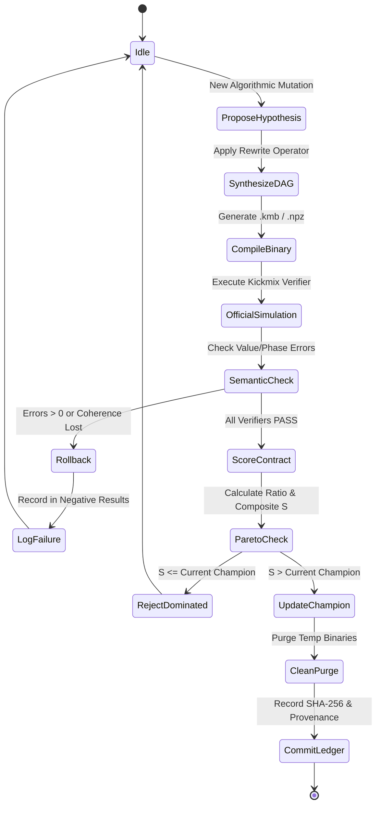

# APPLICATION FLOW (AppFlow)
## Berlioz — Verifiable Quantum Circuit Compilation Engine

**Framework:** Syzygy Spec-Driven Development Standard (v1.0.0)  

---

### 1. Evaluator-Guided Optimization State Machine

---

### 2. Failure Rollback & Negative Results Policy
* Any candidate that produces non-zero value errors, non-zero phase drift, or fails ancilla cleanup is immediately aborted.
* Intermediate scratch binaries are purged from disk to prevent working tree contamination.
* All negative results are permanently recorded in `research/ml16_experiment_registry.json`.
