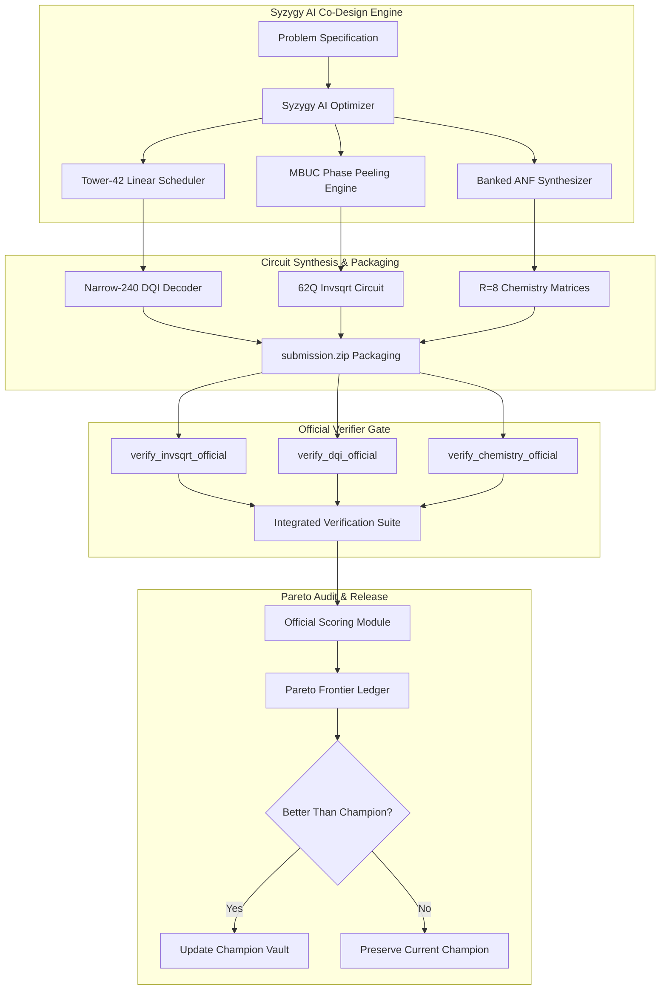

# SYSTEM ARCHITECTURE
## Berlioz — Verifiable Quantum Circuit Compilation Engine

**Framework:** Syzygy Spec-Driven Development Standard (v1.0.0)  

---

### 1. Component Topology Mesh

---

### 2. Module Responsibilities
* **`src/syzygy_ai_quantum_optimizer.py`:** Autonomous evaluator-guided optimization passes.
* **`extracted_dqi/blocks/dqi/team-1028-narrow240/source/`:** 86 verified DQI algorithm units.
* **`audit/integrated_verification_suite.py`:** Standalone end-to-end official benchmark verifier harness.
* **`src/verify_portfolio.py`:** Canonical portfolio scoring and resource accounting module.
