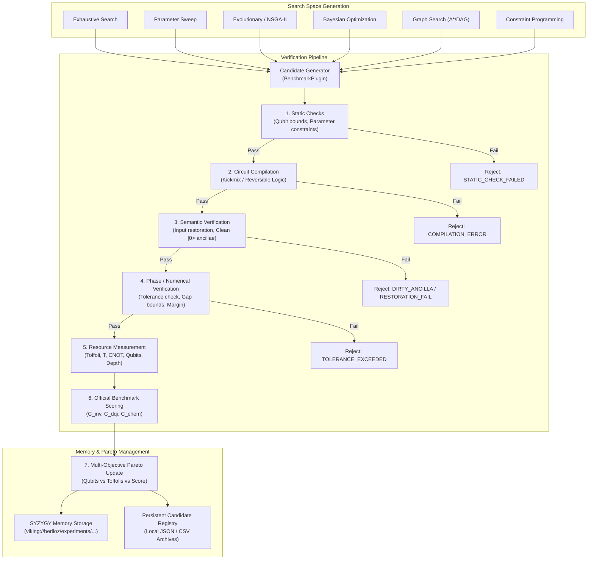

# ML26 PART 6: Reusable Algorithm-to-Circuit Candidate Discovery Architecture

**Author:** BERLIOZ Discovery Agent (Autonomous Reversible Circuit Co-Design Engine)  
**Context:** BERLIOZ MASTERLOOP 26 — PART 6  
**Date:** 2026-10-31  
**Status:** COMPLETE & GROUNDED IN SYZYGY ORCHESTRATION

---

## 1. Executive Summary

The objective of Masterloop 26 Part 6 is to build a **reusable, multi-benchmark, algorithm-to-circuit candidate discovery system**. Rather than relying on manual, ad-hoc tuning of individual circuits, this system formalizes quantum circuit co-design into an autonomous pipeline capable of:
1. Exploring combinatorial algorithmic spaces across different physical representations.
2. Enforcing strict multi-stage verification pipelines (Static $\to$ Compilation $\to$ Semantic $\to$ Phase $\to$ Official Metric).
3. Maintaining persistent Pareto frontiers across multiple benchmark families.
4. Seamlessly integrating with the SYZYGY semantic memory (`viking://berlioz/...`) and the `experiment_registry_schema.json`.
5. Strictly prohibiting automatic, unverified candidate promotion (ensuring the incumbent remains protected until human or formal milestone review).



---

## 2. Common Benchmark Interface Contract

To support Benchmark I (Invsqrt), Benchmark II (DQI Syndrome Decoding), Benchmark III (Chemistry DF-THC), and future quantum algorithms without code duplication, the engine defines the abstract interface `BenchmarkPlugin`:

```python
class BenchmarkPlugin(ABC):
    """Abstract interface defining a self-contained quantum benchmark family."""

    @property
    @abstractmethod
    def benchmark_id(self) -> str:
        """Returns benchmark identifier: 'INVSQRT', 'DQI', or 'CHEMISTRY'."""
        pass

    @property
    @abstractmethod
    def hard_qubit_ceiling(self) -> Optional[int]:
        """Returns hard physical qubit cap if one exists (e.g., 128 for Chemistry, 64 for Invsqrt)."""
        pass

    @abstractmethod
    def generate_candidates(self, strategy: str, **kwargs) -> Iterable[CandidateSpec]:
        """Generates candidate specifications according to the chosen search strategy."""
        pass

    @abstractmethod
    def static_checks(self, spec: CandidateSpec) -> CheckResult:
        """Fast pre-compilation filtering (qubit estimation, parameter feasibility)."""
        pass

    @abstractmethod
    def compile(self, spec: CandidateSpec) -> CandidateArtifact:
        """Synthesizes or compiles the candidate specification into executable circuit representations."""
        pass

    @abstractmethod
    def semantic_verification(self, artifact: CandidateArtifact) -> SemanticResult:
        """Verifies bit-exact input restoration and 100% clean ancilla return to |0>."""
        pass

    @abstractmethod
    def phase_verification(self, artifact: CandidateArtifact) -> PhaseResult:
        """Verifies numerical accuracy, SOS eigenvalue bounds, and remaining margin slack."""
        pass

    @abstractmethod
    def measure_resources(self, artifact: CandidateArtifact) -> ResourceMetrics:
        """Extracts physical circuit resources (Qubits, Toffolis, T-count, CNOTs, Depth)."""
        pass

    @abstractmethod
    def official_scoring(self, metrics: ResourceMetrics, phase: PhaseResult) -> ScoreResult:
        """Computes official competition metric and ratio against historical baseline."""
        pass
```

---

## 3. Supported Benchmark Family Implementations

### 3.1 Benchmark I: Invsqrt (`INVSQRT`)
- **Domain:** $x \in [1, 3{,}133{,}452]$, width $W = 22\text{ qubits}$, $\beta = 1.0$.
- **Tolerance:** $\text{tol}(x) = 2^{-24}/\sqrt{x} \pmod 1$.
- **Official Scoring:** $\text{Score} = Q \times C = Q \times (\text{Toffolis} + T / 4)$.
- **Search Dimensions:** Range reduction shift methods, subinterval partition counts $K \in \{1, 2, 4, 8\}$, polynomial degrees $d \in \{2, 3, 4\}$, Horner accumulator schedules, rotation synthesis $\varepsilon$.
- **Hard Constraints:** $Q \le 64$, input $x$ restored bit-exact, 100% clean scratch ancillae.

### 3.2 Benchmark II: DQI Syndrome Decoding (`DQI`)
- **Domain:** Reed-Solomon $[4095, 4025, 71]$ over $\mathbb{F}_{2^{12}}$, $t = 35$ errors, 70 syndrome inputs.
- **Official Scoring:**
  $$C_{\text{dqi}} = \frac{(3 \cdot 2^{21} + \text{shots}) \cdot T \cdot Q}{\text{passes}}$$
  Clopper-Pearson lower bound ratio $R = \text{ratio}_{\text{raw}} / 1.19126$.
- **Search Dimensions:** RiBM unrolling stages, systolic cell array dimensions, Additive FFT subfield embeddings, Direct syndrome decompositions, Reversible pebbling DAG checkpoints, MBUC Pauli-frame trackers.
- **Hard Constraints:** Passes $\ge 1$, Clopper-Pearson $p \ge 0.999$, zero dirty ancilla leakage.

### 3.3 Benchmark III: Chemistry FeMoCo DF-THC (`CHEMISTRY`)
- **Domain:** FeMoCo76o113e Hamiltonian with Sum-of-Squares shift, 75 Givens rotation angles.
- **Official Scoring:** $\text{Score} = \lambda_{\text{eff}} \cdot T_{\text{total}} \cdot Q_{\text{total}}$.
- **Search Dimensions:** Factorization rank $R \in \{6, 8, 10, 12\}$, orbital basis counts $(B, C)$, rotation bitwidth $\text{brot} \in \{8, 10\}$, batching size $J \in \{1, 3, 4, 5, 7\}$, QROM memory architecture (`unary`, `select_swap`, `banked_2addr`, `banked_4addr_pebble`, `exact_gauge`).
- **Hard Constraints:** Every ANGLE circuit $Q_{\text{circ}} \le 128\text{ qubits}$, two-body residual error $\le 20\text{ mHa}$ ($\le 1\text{ mHa}$ chemical accuracy).

---

## 4. Multi-Search Strategy Engine

The discovery engine decouples the search strategy from the benchmark plugin, providing six distinct algorithmic search modules:

1. **Exhaustive Discrete Search (`ExhaustiveSearch`):**
   Exhaustively enumerates every discrete combination over bounded parameter grids (e.g. all valid $(J, \text{brot}, \text{mode})$ triples). Guarantees global optimality on small spaces.
2. **Multi-Dimensional Parameter Sweep (`ParameterSweep`):**
   Structured coarse-to-fine grid sweeps across continuous/integer hyperparameter intervals (e.g. coefficient truncation thresholds, scaling factors).
3. **Evolutionary Multi-Objective Optimization (`EvolutionarySearch` / NSGA-II):**
   Maintains a population of candidate genomes mutating structural hyper-parameters. Evaluates non-dominated sorting across the dual objectives:
   $$\min f_1 = Q, \quad \min f_2 = T_{\text{equiv}}$$
4. **Surrogate-Assisted Bayesian Optimization (`BayesianSearch`):**
   Fits Gaussian Process / Random Forest surrogates over computationally expensive continuous metrics (such as $\lambda_{\text{eff}}$ as a function of continuous THC regularization weights), sampling points via Expected Improvement (EI).
5. **Graph / DAG Exploration (`GraphSearch`):**
   Explores dependency graphs for reversible pebbling and circuit decomposition using heuristic A* search and branch-and-bound pruning.
6. **Constraint Programming (`ConstraintSearch`):**
   Encodes register lifetime allocation and shared ancilla packing as a Constraint Satisfaction Problem (CSP), querying SAT/ILP solvers to verify whether a circuit can fit within $Q \le Q_{\text{cap}}$.

---

## 5. Candidate Lifecycle & Reproducibility Guarantee

Every candidate processed by the engine is assigned a unique, immutable, reproducible identifier:
$$\text{CAND-}\{\text{BENCHMARK}\}\text{-}\{\text{STRATEGY}\}\text{-}\{\text{HASH8}\}$$

For every candidate, the engine records:
1. Complete input configuration dictionary and random seeds.
2. Source code git revision hash and compiler version.
3. Timestamp, execution duration, and host environment telemetry.
4. Step-by-step verification status flags (`STATIC_PASS`, `COMPILE_PASS`, `SEMANTIC_PASS`, `PHASE_PASS`).
5. Complete resource footprint (Qubits, Toffolis, T-gates, CNOTs, Depth).
6. Official score and ratio versus baseline.
7. Verification evidence file links.

All records strictly conform to [`ml26/experiment_registry_schema.json`](file:///c:/Users/noobg/.gemini/antigravity-ide/scratch/berlioz/ml26/experiment_registry_schema.json) and are stored in SYZYGY semantic memory:
$$\text{URI: } \texttt{viking://berlioz/experiments/}\{\text{candidate\_id}\}$$

---

## 6. Strict Non-Auto-Promotion Safety Policy

To protect the integrity of verified competition baselines:
- Discovered candidates that achieve a lower cost than the current incumbent are **flagged as `CANDIDATE_SUPERIOR`**.
- The candidate is recorded in the Pareto frontier archive (`ml26/pareto_frontier_master.json`) with an explicit recommendation.
- **The incumbent artifact is NEVER automatically overwritten.**
- Promotion requires explicit user instruction, cryptographic hash verification, and formal regression sign-off.
