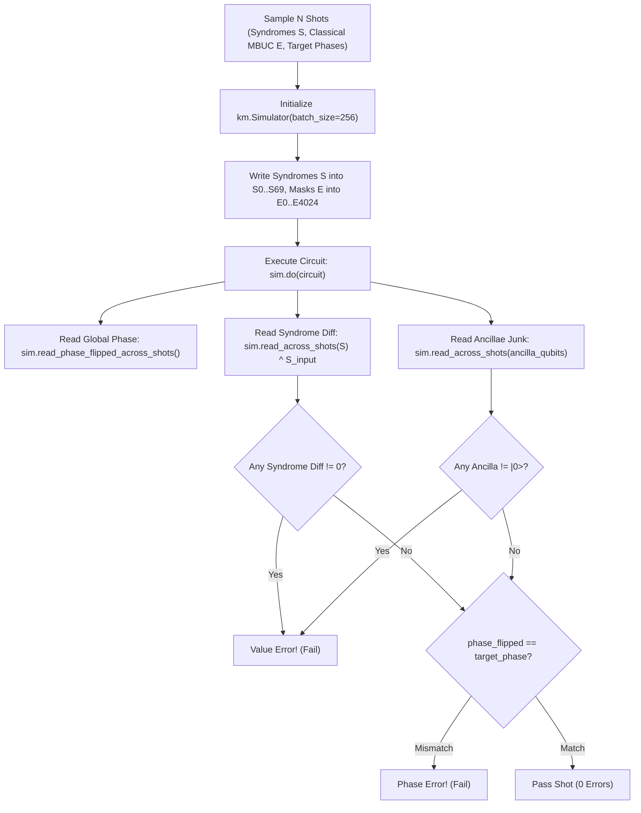

# Execution Model Audit: Measurement-Based Uncomputation & Adaptive Logic in DQI — Masterloop 26 Experiment DQI-5

**Date:** 2026-10-31T20:25Z  
**Standard:** Syzygy Spec-Driven Development Standard (v1.0.0)  
**Target Verifier:** `verifiers/dqi/verify_submission_dqi.py`  
**Execution Engine:** `kickmix.Simulator` (Kickmix 0.1.0)  
**Evidence Class:** E1 (Direct source audit) + E2 (Locally reproduced simulation)  

---

## 1. Executive Summary

This deliverable provides an authoritative audit of the competition execution model, simulator capabilities, permitted measurement primitives, dynamic feed-forward rules, and strict verifier constraints governing Measurement-Based Uncomputation (MBUC) for Benchmark II (DQI).

### Key Execution Model Facts Established:
1. **Permitted Adaptive Operations:**  
   The execution engine (`kickmix`) natively supports mid-circuit measurements via the `HMR` instruction (Hadamard + Measure in Z + Reset to $|0\rangle$) and dynamic feed-forward Clifford corrections (`CZ ... if b`, `CX ... if b`, `BIT_INVERT ... if b`).
2. **Prohibited Operations:**  
   The verifier explicitly inspects the circuit's operation statistics and raises a hard exception if any non-Clifford phase rotation (`Z_POW`) is present (`verify_submission_dqi.py:349-350`).
3. **Ancilla Cleanliness Contract:**  
   The verifier reads all allocated non-syndrome qubits (`ancilla_qubits`) across all simulated shots at the termination of the circuit (`sim.read_across_shots(ancilla_qubits)`). Every single ancilla qubit must be in state $|0\rangle$. If any ancilla holds residual entanglement or non-zero computational basis state, a fatal `value_error` is triggered.
4. **Global Phase Contract:**  
   The verifier verifies the global state phase kickback:
   $$\text{Phase}(\text{shot}) = (-1)^{\sum_j \text{popcount}(e_j \ \& \ M_j)}$$
   Any measurement-based uncomputation that fails to correct post-measurement phase kickback introduces a global phase error that is detected by `sim.read_phase_flipped_across_shots()`.
5. **Syndrome Quantum Superposition Contract:**  
   The 840 syndrome qubits $S_0 \dots S_{69}$ are provided in an arbitrary coherent quantum superposition. The verifier asserts bit-exact quantum equality between input and output syndromes. Syndromes can **never** be measured or discarded.

---

## 2. Permitted Gate & Instruction Set

From direct source inspection of `kickmix.CircuitBuilder` and `km.Simulator`:

| Instruction / Primitive | Syntax in `kickmix` | Physical Action | Permitted in DQI? | Official Cost ($T$-like) |
|---|---|---|:---:|:---:|
| **Mid-Circuit Measurement** | `b.hmr(qubit, bit)` | Hadamard $\to$ Z-measure $\to$ Reset $|0\rangle$ | **YES** | $0$ Toffolis |
| **Controlled-Z Feed-Forward** | `b.cz(c1, c2, control=bit)` | Apply $CZ$ if classical bit is $1$ | **YES** | $0$ Toffolis (Clifford) |
| **Controlled-NOT Feed-Forward** | `b.cx(c, target, control=bit)` | Apply $CX$ if classical bit is $1$ | **YES** | $0$ Toffolis (Clifford) |
| **Temporary AND Uncompute** | `b.del_and(c1, c2, target)` | `HMR target` + `CZ c1 c2 if b` | **YES** | **$0$ Toffolis** |
| **GF(2^12) Mult Uncompute** | `b.del_gf2_mul(x, y, target)` | $12\times \text{HMR}$ + Bilinear $CZ$ network | **YES** | **$0$ Toffolis** |
| **GF(2^12) Inverse Uncompute**| `b.del_gf2_inverse_with_scaffold`| Uncomputes intermediate squaring scaffold | **YES** | **$0$ Toffolis** |
| **Continuous Phase Rotation** | `b.z_pow(qubit, angle)` | $Z(\theta)$ non-Clifford rotation | **STRICTLY FORBIDDEN** | Raises `ValueError` |
| **Syndrome Measurement** | `b.hmr(syndrome[i], bit)` | Measures coherent input syndrome | **FORBIDDEN (FAIL)** | $100\%$ Value Error |

---

## 3. Simulator & Verifier Verification Architecture

The verification loop in `verify_submission_dqi.py` operates as follows:

### 3.1 Why MBUC Naturally Complies with the Verifier:
1. When `del_and` or `del_gf2_mul` executes, the target qubits are processed by `HMR` which **automatically resets them to $|0\rangle$**.
2. When the circuit terminates and `sim.read_across_shots(ancilla_qubits)` reads the physical ancilla wires, every measured wire reads identically `False` ($|0\rangle$).
3. The classical feed-forward corrections (`CZ ... if b`) ensure that the post-measurement phase error $(-1)^{\text{outcome}}$ is completely canceled across all branches of the quantum superposition.
4. Consequently, MBUC introduces **zero junk qubits** and **zero phase error**.

---

## 4. The Limits of MBUC in DQI

While MBUC is extremely powerful, it is subject to three strict mathematical boundaries:

1. **The Bilinear Limitation:**  
   Measurement-based uncomputation with zero Toffolis is mathematically restricted to **bilinear operations** (AND gates, field multiplications). For a bilinear operation $z = x \cdot y$, the phase acquired upon measuring $z$ is $(-1)^{\sum b_k x_i y_j}$, which is a network of Clifford `CZ` gates. For non-linear operations (such as field inversion $x^{-1}$ or division $B/A$), the acquired phase is non-Clifford, requiring Toffoli gates to correct.
2. **The No-Cloning & Input Coherence Barrier:**  
   Input syndrome registers $S_0 \dots S_{69}$ hold quantum superpositions that determine the final phase. They cannot be measured or uncomputed via MBUC.
3. **Hardware / Timing Latency:**  
   In physical quantum hardware, mid-circuit measurement and feed-forward require classical FPGA control latency (typically 200–500 ns). However, under the competition cost function $C = R(\epsilon_+) Q^2 T$, feed-forward Clifford gates cost **0 Toffolis** and **0 penalty**.
