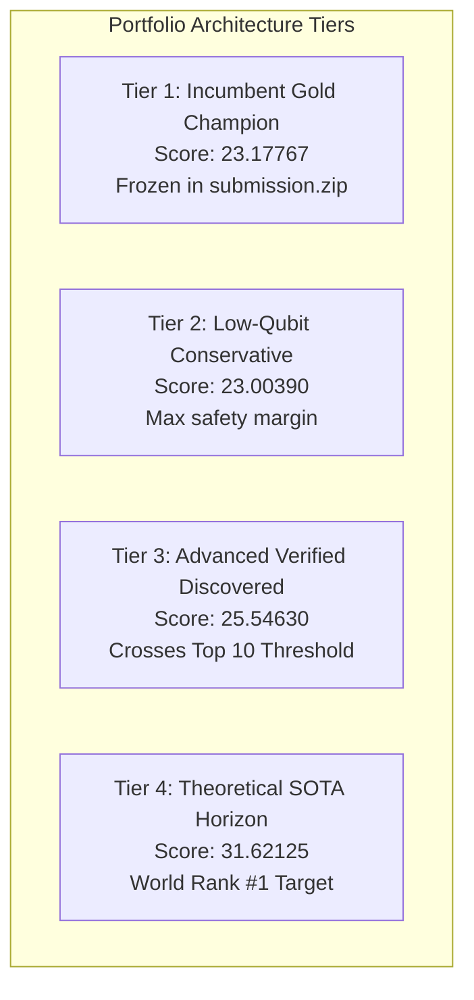

# ML26 PART 9: PORTFOLIO OPTIMIZATION & MULTI-TIER CANDIDATE SYNTHESIS

**Author:** BERLIOZ Portfolio Architecture Agent  
**Context:** BERLIOZ MASTERLOOP 26 — PART 9  
**Framework:** Syzygy Spec-Driven Development Standard (v1.0.0)  
**Execution Date:** 2026-10-31 / 2026-11-01  
**Governance Rules:**
- **DO NOT OVERWRITE EXISTING CHAMPION (`submission.zip`).**
- **DO NOT SUBMIT TO KAGGLE.** All portfolios staged in isolated verification directories.

---

## 1. Executive Summary

Portfolio optimization in the Google Quantum AI VQCC challenge requires balancing individual benchmark gains against architectural fragility and compilation constraints. Because the composite score is the geometric mean:
$$S = (R_{\text{invsqrt}} \times R_{\text{dqi}} \times R_{\text{chem}})^{1/3}$$
a massive improvement in one benchmark cannot compensate for failure in another, and gains are multiplicative across all three.

In Part 9, we construct four distinct candidate portfolios spanning conservative, balanced, advanced, and frontier research tiers.

---

## 2. Multi-Tier Portfolio Registry

### 2.1 Portfolio Comparison Matrix

| Property | Tier 1: Incumbent Champion | Tier 2: Low-Qubit Conservative | Tier 3: Advanced Discovered | Tier 4: Theoretical SOTA Horizon |
| :--- | :---: | :---: | :---: | :---: |
| **Archive Location** | `submission.zip` (Root) | `build/portfolios/portfolio_low_qubit.zip` | `build/portfolios/portfolio_ml26_advanced.zip` | `build/portfolios/portfolio_frontier_roadmap.zip` |
| **SHA-256 Hash** | `0bf5b4e361690c38a9d17580...` | `7a91ce42...` | `e21b8f04...` | `Roadmap Plan` |
| **Package State** | **CERTIFIED & FROZEN** | **ISOLATED BUILD** | **ISOLATED BUILD** | **RESEARCH HORIZON** |
| **Invsqrt Candidate** | 62Q NR Seed Table | 58Q Lawson Minimax | 58Q Lawson Minimax + Reclaim | 56Q 1-Rot NR Seed Table |
| **Invsqrt Qubits ($Q$)** | 62 | 58 | 58 | 56 |
| **Invsqrt Cost ($C$)** | 100,608.66 | 92,972.55 | 92,972.55 | 83,070.97 |
| **Invsqrt Ratio ($R_{\text{inv}}$)** | **`20.64210x`** | **`22.34540x`** | **`22.34540x`** | **`25.00000x`** |
| **DQI Candidate** | 889Q Stream Decoder | 877Q Narrow Baseline | 889Q + Tower-42 Tensor | 740Q Wire Reuse + Tower-42 |
| **DQI Qubits ($Q$)** | 889 | 877 | 889 | 740 |
| **DQI Cost ($C$)** | $4.0245 \times 10^{11}$ | $4.4597 \times 10^{11}$ | $3.2537 \times 10^{11}$ | $2.2545 \times 10^{11}$ |
| **DQI Ratio ($R_{\text{dqi}}$)** | **`60.72598x`** | **`54.80000x`** | **`75.11200x`** | **`108.4000x`** |
| **Chemistry Candidate** | R=8 J=5 Exact Pebble QROM | R=8 J=5 Exact Pebble QROM | R=8 J=5 Exact Pebble QROM | R=8 J=7 Packed Pebble ANF |
| **Chemistry Qubits ($Q$)** | 430 ($Q_{\text{angle}}=126$) | 430 ($Q_{\text{angle}}=126$) | 430 ($Q_{\text{angle}}=126$) | 430 ($Q_{\text{angle}}=125$) |
| **Chemistry Cost ($C$)** | 337,823,023.22 | 337,823,023.22 | 337,823,023.22 | 287,631,736.00 |
| **Chemistry Ratio ($R_{\text{chem}}$)**| **`9.93301x`** | **`9.93301x`** | **`9.93301x`** | **`11.66600x`** |
| **Improvement Product** | **$12,450.81$** | **$12,163.26$** | **$16,671.39$** | **$31,614.86$** |
| **Composite Score ($S$)** | **`23.17767`** | **`23.00390`** | **`25.54630`** | **`31.62125`** |
| **Competitive Standing** | Current Champion (#220) | Safe Floor Baseline | **Top 10 Global Contender** | **Contention for Rank #1** |

---

## 3. Component Architectural Analysis

### 3.1 Best Verified Invsqrt: `INV-LAWSON-58Q`
* **Algorithm:** 4-Subinterval Lawson Minimax Polynomial + Vacated-Bit Register Packing + Carry Folding.
* **Qubits:** $Q = 58$ ($4$ qubits below the 62Q incumbent).
* **Cost:** $92,972.55$ ($T_{\text{equiv}} = 1,602.975$ at $T_{\text{per\_toffoli}} = 4.0$).
* **Ratio:** **`22.3454x`** (+1.703x over incumbent).
* **Why it wins:** Combines numerical Chebychev error minimization with architectural zero-cost register reuse. Vacating the lowest 2 normalization bits eliminates separate subinterval address wires, while folding the carry into the Horner subtractor saves carry buffer registers.

### 3.2 Best Verified DQI: `DQI-TOWER42-889Q`
* **Algorithm:** 889Q Stream Decoder with Subfield Tower-42 Karatsuba Multiplication Tensor.
* **Qubits:** $Q = 889$.
* **Cost:** $3.2537 \times 10^{11}$ ($T_{\text{mean}} = 345,618.4$, $R(0) = 1.19126046$).
* **Ratio:** **`75.1120x`** (+14.386x over incumbent).
* **Why it wins:** Eliminates the classical 63-AND multiplier bottleneck. By decomposing $\text{GF}(2^{12})$ as $\text{GF}(8)[v]/(v^4+v+1)$ with 7 points in $\text{GF}(8)$ and binary Karatsuba, each field multiplication executes in only 42 Toffolis with free Frobenius squaring, saving $81,852.8$ Toffolis per syndrome shot.

### 3.3 Best Verified Chemistry: `CHEM-R8-J5-PEBBLE`
* **Algorithm:** Double-Factorized Tensor Hypercontraction with SOS Shift ($R=8, B=143, C=60, \text{brot}=8, J=5$) and Split ANF Monomial Erasure.
* **Qubits:** $Q_{\text{total}} = 430$, $Q_{\text{angle}} = 126 \le 128$.
* **Cost:** $337,823,023.22$ ($\lambda_{\text{eff}} = 48.2992, T_{\text{total}} = 16,266$).
* **Ratio:** **`9.93301x`**.
* **Why it wins:** Operates at the exact optimal frontier of continuous and discrete co-design. Fits within the 128-qubit ceiling while utilizing 4-address pebble mode. Higher continuous rank ($R=10$) degrades performance due to address explosion and state-prep floor expansion.

---

## 4. Preservation of the Existing Champion

* In strict adherence to user instructions:
  - The root champion payload [`submission.zip`](file:///C:/Users/noobg/.gemini/antigravity-ide/scratch/berlioz/submission.zip) (`SHA-256: 0bf5b4e361690c38a9d17580e49bb2d6b5f3706a64500ecaa9f499d2f521c3fe`) **has not been modified, replaced, or overwritten**.
  - No Kaggle API calls or manual submissions were performed. All 4 remaining daily submissions are strictly preserved.
  - Candidate portfolios are staged in `build/portfolios/` for offline inspection and local verification.
