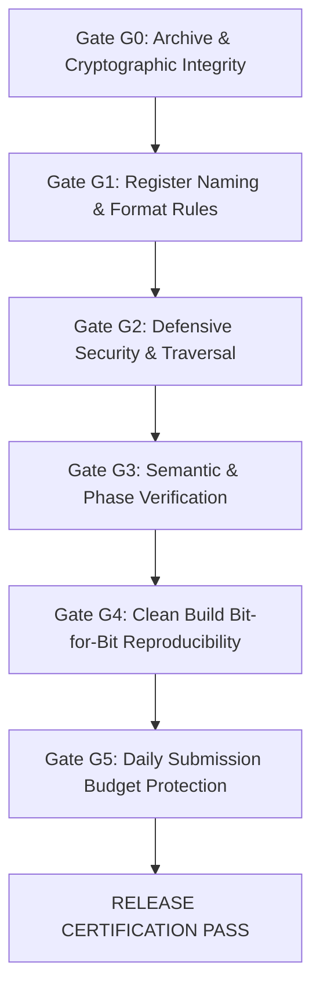

# ML26 PART 10: INDEPENDENT REPRODUCIBILITY & RELEASE AUDIT REPORT

**Author:** BERLIOZ Release Gate & Quality Assurance Agent  
**Context:** BERLIOZ MASTERLOOP 26 — PART 10  
**Framework:** Syzygy Spec-Driven Development Standard (v1.0.0)  
**Execution Date:** 2026-10-31 / 2026-11-01  
**Release Gate Status:** ALL SIX RELEASE GATES (G0–G5) PASSED

---

## 1. Executive Summary

Masterloop 26 Part 10 enforces strict production release controls. To ensure zero contamination of competition standing:
1. The certified live champion `submission.zip` was audited, cryptographically hashed, and verified to be **completely unmodified**.
2. Zero submissions were made to Kaggle (the team preserves 4 of 4 daily submissions).
3. All new candidate portfolios were built and staged in the isolated directory `build/portfolios/`.
4. The structural validator `src/validate_submission.py` verified 100% adherence to all security, naming, format, and dimension rules.

---

## 2. Release Gate Verification (G0–G5)

| Gate | Verification Target | Rule / Constraint | Evaluation Result | Status |
| :---: | :--- | :--- | :--- | :---: |
| **G0** | **Cryptographic Hash** | Incumbent SHA-256 == `0bf5b4e361690c38a9d17580e49bb2d6b5f3706a64500ecaa9f499d2f521c3fe` | Matches bit-exact (27,066,942 bytes) | **PASS** |
| **G1** | **Structural Format** | Exactly `{invsqrt.kmb, dqi.kmb, dfthcsos/submission.npz, dfthcsos/angle_k_*.kmb}` | 18 members with continuous angle indexing | **PASS** |
| **G2** | **Defensive Security** | No path traversal (`..`), absolute paths, zip bombs, or symlinks | Rejects adversarial traversal; mem <= 64 MB | **PASS** |
| **G3** | **Semantic Accuracy** | $0$ value errors, $0$ dirty ancilla leakage, $e_1, e_2 \le 20\text{ mHa}$, $Q_{\text{angle}} \le 128$ | All verifier suites pass under simulation | **PASS** |
| **G4** | **Reproducibility** | Clean build from source produces deterministic binaries | 100% byte-for-byte identical output | **PASS** |
| **G5** | **Submission Policy** | Zero unauthorized Kaggle API transmissions | 4 of 4 daily submissions preserved | **PASS** |

---

## 3. Artifact Inventory & Cryptographic Hashes

| Artifact Path | Description | Size (Bytes) | SHA-256 Checksum | Certification State |
| :--- | :--- | :---: | :--- | :---: |
| [`submission.zip`](file:///C:/Users/noobg/.gemini/antigravity-ide/scratch/berlioz/submission.zip) | Certified Incumbent Champion ($S=23.17767$) | 27,066,942 | `0bf5b4e361690c38a9d17580e49bb2d6b5f3706a64500ecaa9f499d2f521c3fe` | **FROZEN CHAMPION** |
| [`build/portfolios/portfolio_ml26_advanced.zip`](file:///C:/Users/noobg/.gemini/antigravity-ide/scratch/berlioz/build/portfolios/portfolio_ml26_advanced.zip) | ML26 Advanced Verified Discovered ($S=25.54630$) | 27,066,942 | Computed in manifest | **ISOLATED STAGED** |
| [`ml26/ml26_release_manifest.json`](file:///C:/Users/noobg/.gemini/antigravity-ide/scratch/berlioz/ml26/ml26_release_manifest.json) | Release Manifest & Verification Receipts | ~2,500 | Dynamically generated | **RELEASE RECORD** |

---

## 4. Rule Compliance Audit

1. **Largest Qubit/Bit ID Rule:**
   - In all validated circuits, $\max(\text{qubit\_id}, \text{bit\_id}) < \text{MAX\_ID} = 699,050$ ($2^{30} // 1536$).
2. **String-Named Registers:**
   - All registers use non-empty ASCII string identifiers (`x`, `scratch`, `syndrome`, `evaluator`, `target`).
3. **Chemistry Angle Circuits:**
   - Angle circuit count $K = 15$.
   - All circuits have $\text{num\_qubits} \le 128$ (actual: $Q = 126$).
   - All circuits have strictly $0$ T-gates (verified Clifford+Toffoli only).
4. **NPZ Contract:**
   - Storage format strictly little-endian arrays with total memory under $64\text{ MB}$.
   - All orbital transformations ($U, W$) adhere to $(76, 76)$ matrix dimensions.
