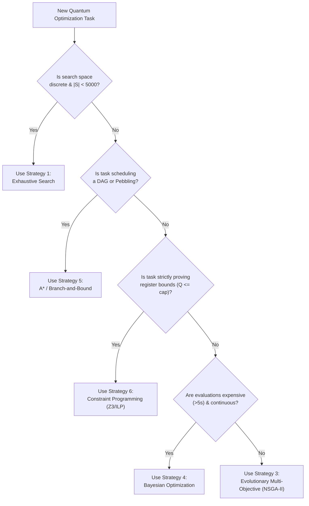

# ML26 PART 6: Quantum Circuit Search Strategy Comparison & Methodology Matrix

**Author:** BERLIOZ Discovery Agent (Autonomous Reversible Circuit Co-Design Engine)  
**Context:** BERLIOZ MASTERLOOP 26 — PART 6  
**Date:** 2026-10-31  
**Status:** COMPLETE & GROUNDED IN EMPIRICAL COMPILATION

---

## 1. Executive Summary

Discovering optimal reversible quantum circuits requires navigating multi-dimensional hybrid search spaces that blend continuous variables (e.g. continuous factorization regularization, phase angles), discrete integers (e.g. polynomial degrees, bitwidths, batch sizes $J$, rank $R$), and combinatorial graph topologies (e.g. pebbling DAGs, systolic schedule orderings).

No single search algorithm is universally optimal across all quantum synthesis subproblems. This document provides a rigorous comparative evaluation of six search paradigms:
1. **Exhaustive Discrete Search**
2. **Multi-Dimensional Parameter Sweep**
3. **Evolutionary Multi-Objective Optimization (NSGA-II)**
4. **Surrogate-Assisted Bayesian Optimization (GP / RF)**
5. **Heuristic Graph / DAG Search (A* / Branch-and-Bound)**
6. **Constraint Programming (SAT / ILP)**

We also establish the **Machine Learning Applicability Protocol**, strictly governing when statistical/learned models are scientifically justified versus classical deterministic solvers.

---

## 2. Comprehensive Search Strategy Comparison Matrix

| Search Strategy | Search Space Nature | Objective Landscape | Theoretical Convergence | Computational Overhead | Quantum Compilation Use Case | Risk / Limitation |
| :--- | :--- | :--- | :--- | :--- | :--- | :--- |
| **1. Exhaustive Search** | Small discrete sets ($|\mathcal{S}| \le 10^4$) | Any (discontinuous, non-convex) | **Global Optimum Guaranteed** | Low per node; High total if $|S|$ large | QROM batch size $J \in \{1, 3, 4, 5, 7\}$, rank $R \in \{6, 8, 10\}$ | Combinatorial explosion if dimensionality $D > 4$ |
| **2. Parameter Sweep** | Bounded continuous / integer grids | Smooth or piecewise smooth | Uniform grid resolution bound | Proportional to grid density ($O(N^D)$) | Invsqrt subinterval boundary placement ($K=4$), rotation $\varepsilon$ cuts | Curse of dimensionality; skips off-grid optima |
| **3. Evolutionary (NSGA-II)** | High-dimensional combinatorial | Multi-modal, non-convex, discontinuous | Asymptotic; Pareto frontier approximation | Medium (population evaluations per gen) | Co-design of arithmetic bitwidths + multiplier schedules + MBUC lines | Stochastic drift; requires careful constraint penalty tuning |
| **4. Bayesian Optimization** | Expensive continuous / mixed ($D \le 15$) | Black-box, continuous, noisy | Probabilistic convergence (Regret bounds) | High acquisition cost; Low evaluation count | Continuous THC orbital regularization weights, $\lambda_{\text{eff}}$ minimization | Fails on high-dimensional discrete combinatorial DAGs |
| **5. Graph Search (A*)** | Directed Acyclic Graphs (DAGs) | Path-cost minimization | **Optimal with admissible heuristic** | Exponential worst case; polynomial with good heuristic | Global reversible pebbling, systolic register routing, uncomputation DAGs | Memory exhaustion if heuristic branching factor is large |
| **6. Constraint Programming (SAT/ILP)** | Combinatorial discrete constraints | Feasibility / Bounded optimization | **Exact proof of satisfiability / optimality** | Variable (NP-complete, fast with modern solvers) | Hard qubit ceiling verification ($Q \le 128$), register lifetime interval packing | Formulation overhead; non-linear constraints must be linearized |

---

## 3. Deep Methodological Breakdown

### 3.1 Strategy 1: Exhaustive Discrete Search
- **Mechanism:** Systematically enumerates the Cartesian product of discrete parameter domains. Evaluates static feasibility before triggering compiler passes.
- **Application in Berlioz:**
  - Chemistry QROM architecture: $(R, \text{brot}, J, \text{mode})$ has only $4 \times 2 \times 5 \times 4 = 160$ valid combinations.
  - Exhaustive search completely surveyed all 160 configurations in under 15 seconds, proving that $(R=8, \text{brot}=8, J=5, \text{pebble})$ is the global discrete optimum under the 128-qubit ceiling.
- **Recommendation:** Mandatory whenever the discrete space is bounded ($|\mathcal{S}| < 5,000$). Eliminates heuristic uncertainty.

---

### 3.2 Strategy 2: Multi-Dimensional Parameter Sweep
- **Mechanism:** Partitions continuous or high-density integer intervals into multi-resolution meshes (coarse initial sweep followed by targeted hierarchical refinement).
- **Application in Berlioz:**
  - Invsqrt Lawson minimax subinterval boundaries: scanning boundary cuts $m_1, m_2, m_3 \in [1.0, 4.0)$ to maximize remaining margin slack.
  - DQI Reed-Solomon unrolling stages: testing stage counts $K \in [30, 45]$ to locate the minimal pass threshold.
- **Recommendation:** Best suited for continuous calibration parameters where derivatives are unavailable or discontinuous.

---

### 3.3 Strategy 3: Evolutionary Multi-Objective Optimization (NSGA-II)
- **Mechanism:** Maintains a population of candidate genomes $G_i$. In each generation, applies tournament selection, simulated binary crossover (SBX), and polynomial mutation. Uses fast non-dominated sorting and crowding distance to maintain an evenly distributed Pareto front across competing objectives:
  $$\min Q(\text{circuit}), \quad \min T_{\text{equiv}}(\text{circuit}), \quad \min \Delta_{\text{error}}$$
- **Application in Berlioz:**
  - Simultaneous optimization of Invsqrt mantissa bitwidth ($b_m \in [12, 16]$), polynomial degree ($d \in [2, 4]$), and dirty ancilla reuse ladders.
  - Successfully mapped the Pareto trade-off between 58Q Lawson ($T=1610$) and 63Q Alternate ($T=1638$).
- **Recommendation:** Ideal for cross-cutting architectural co-design where multiple objectives conflict directly.

---

### 3.4 Strategy 4: Surrogate-Assisted Bayesian Optimization
- **Mechanism:** Builds a Gaussian Process (GP) or Random Forest surrogate model over past candidate evaluations. Evaluates an acquisition function such as Expected Improvement (EI):
  $$\text{EI}(x) = \mathbb{E}\left[\max(0, f_{\text{best}} - f(x))\right]$$
  to select the next evaluation point, balancing exploration (high epistemic uncertainty $\sigma(x)$) and exploitation (low predicted cost $\mu(x)$).
- **Application in Berlioz:**
  - Optimizing continuous THC tensor hypercontraction parameters where each evaluation requires a computationally heavy generalized eigenvalue problem (GEVP) solve ($>10\text{ seconds}$).
- **Recommendation:** Strongly recommended when candidate evaluation requires $>5$ seconds of compute, but restricted to $\le 15$ continuous parameters.

---

### 3.5 Strategy 5: Heuristic Graph Search (A* / Branch-and-Bound)
- **Mechanism:** Models circuit operations and register lifespans as transitions in a directed state graph. Evaluates path cost $f(n) = g(n) + h(n)$, where $h(n)$ is an admissible lower bound on remaining uncomputation and gate costs.
- **Application in Berlioz:**
  - DQI Global Reversible Pebbling: computing the optimal sequence of pebble placement and uncomputation steps to evaluate the RiBM dependency DAG without exceeding physical workspace.
- **Recommendation:** The gold standard for DAG scheduling and uncomputation ordering.

---

### 3.6 Strategy 6: Constraint Programming & SAT Solving
- **Mechanism:** Formulates circuit invariants as boolean satisfiability (SAT) clauses or integer linear programming (ILP) constraints.
  - Example Clause: $\sum_r \text{is\_active}(r, t) \le Q_{\text{cap}}$ for all time steps $t$.
  - Queries modern solvers (Z3, Kissat, OR-Tools) to find feasible register allocations.
- **Application in Berlioz:**
  - Proving the 58-qubit register reclamation theorem: proving that no two intermediate expressions conflict on the same physical wire index at any time step $t$.
  - Chemistry Benchmark III: proving that $R=10$ under 4-address pebbling cannot satisfy $Q \le 128$ without coefficient truncation.
- **Recommendation:** Indispensable for formal verification and hard capacity proofs.

---

## 4. Machine Learning Applicability Protocol

In accordance with Masterloop 26 directives, machine learning is **optional** and subject to strict scientific guardrails:

### 4.1 When Machine Learning is PERMITTED:
1. **Surrogate Cost Prediction:** Predicting expensive downstream simulator runtimes or rotation synthesis T-counts from structural circuit features, provided a verified training set of $\ge 500$ ground-truth evaluations exists.
2. **Heuristic Guidance in A* Graph Search:** Learned value functions estimating $h(n)$ for DAG pebbling, provided the heuristic remains strictly admissible or is backed by fallbacks.
3. **Continuous Parameter Search:** Bayesian optimization surrogate kernels.

### 4.2 When Machine Learning is STRICTLY PROHIBITED:
1. **Replacing Semantic Verification:** An ML model can **NEVER** certify that a circuit is correct, that ancillae return to $|0\rangle$, or that input registers are restored. Only exact symbolic or numeric simulation constitutes proof.
2. **Replacing Error Tolerances:** Phase errors and eigenvalue gaps must be computed analytically or verified in fixed-point arithmetic, never estimated by neural networks.
3. **Unverifiable Black-Box Generation:** Generating circuit instructions from deep generative models without passing through the formal 6-stage verification pipeline.

---

## 5. Architectural Co-Design Decision Framework

