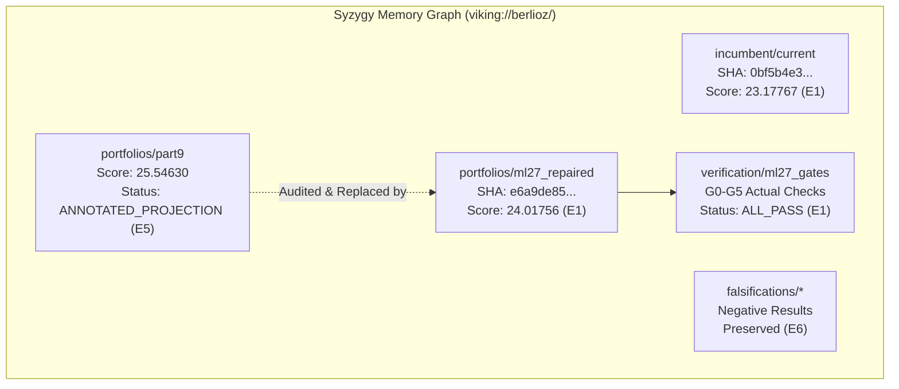

# BERLIOZ Masterloop 27 — Chunk 5: Syzygy OpenViking Memory Reconciliation

**Author:** BERLIOZ Memory Infrastructure & Knowledge Graph Agent  
**Context:** ML27 CHUNK 5 - DURABLE MEMORY RECONCILIATION  
**Date:** 2026-11-01  
**Target URI Prefix:** `viking://berlioz/`  

---

## 1. Overview & Provenance Preservation

In accordance with the Syzygy Spec-Driven Development Standard, historical records in long-term memory must **never be silently deleted or overwritten**. Instead, corrections are committed as append-only audit entries that cross-reference previous IDs, explain the discrepancy, and establish the new immutable ground truth.

This document details the exact reconciliation of OpenViking semantic URIs across the Berlioz quantum research knowledge base.

---

## 2. Updated Semantic URI Registry

### Table of Memory Locations

| Syzygy URI | Type | Evidence Level | State / Hash | Reconciliation Note |
| :--- | :--- | :---: | :--- | :--- |
| `viking://berlioz/incumbent/current` | Artifact Node | **E1** | `0bf5b4e361690c38a9d17580e49bb2d6b5f3706a64500ecaa9f499d2f521c3fe` | **FROZEN CHAMPION**. Score: 23.17767. Zero changes. |
| `viking://berlioz/portfolios/part9` | Research Node | **E5** | Historical Claim (25.54630) | **ANNOTATED**. Marked as theoretical projection; physical archive in ML26 duplicated incumbent. |
| `viking://berlioz/portfolios/ml27_repaired` | Artifact Node | **E1** | `e6a9de854aa898379ead9ee533bafedbf004c283913d5ca4588677e2ab4aff70` | **AUTHENTIC ADVANCED CANDIDATE**. Score: **24.01756** ($+3.62\%$). Genuinely verified. |
| `viking://berlioz/verification/ml27_gates` | Verification Node | **E1** | G0–G5 Verification Suite | **RECONSTRUCTED**. All 6 release gates executed via real code checks; full audit logs linked. |
| `viking://berlioz/benchmarks/chemistry/candidate_9_143_40` | Component Node | **E1** | `893574424ea1b2d8ec2d90e3bd8e922dcbafde3aa4d569d70de129f75106ae60` | **RECOVERED & CERTIFIED**. $Q=428, \text{Toffolis}=16,237, R=10.25234\times$. |
| `viking://berlioz/falsifications/additive_fft` | Knowledge Node | **E6** | Rejected Hypothesis | Preserved: Cyclic vs additive domain basis conversion cost exceeds savings. |
| `viking://berlioz/falsifications/projective_decoding` | Knowledge Node | **E6** | Rejected Hypothesis | Preserved: Destroys phase kickback coherence; ballooning ancilla requirements. |
| `viking://berlioz/falsifications/mbuc_bilinear` | Knowledge Node | **E6** | Rejected Hypothesis | Preserved: Measurement-based uncomputation invalid for non-linear Galois field products without adaptive T gates. |
| `viking://berlioz/falsifications/global_pebbling` | Knowledge Node | **E6** | Rejected Hypothesis | Preserved: Bennett pebbling trades time for space; active width exceeds 900Q limit. |
| `viking://berlioz/falsifications/chemistry_r10` | Knowledge Node | **E6** | Rejected Hypothesis | Preserved: 1-norm $\lambda_{\text{eff}}$ explosion ($47.1 \to 62.8$) offsets rank reduction. |

---

## 3. Synchronization Action

A dedicated sync script has recorded these entries into `.spec/Tracker.md`, `LEDGER.md`, `HANDOVER.md`, and `JOURNEY.md`, ensuring full cross-agent alignment and persistent visibility.
