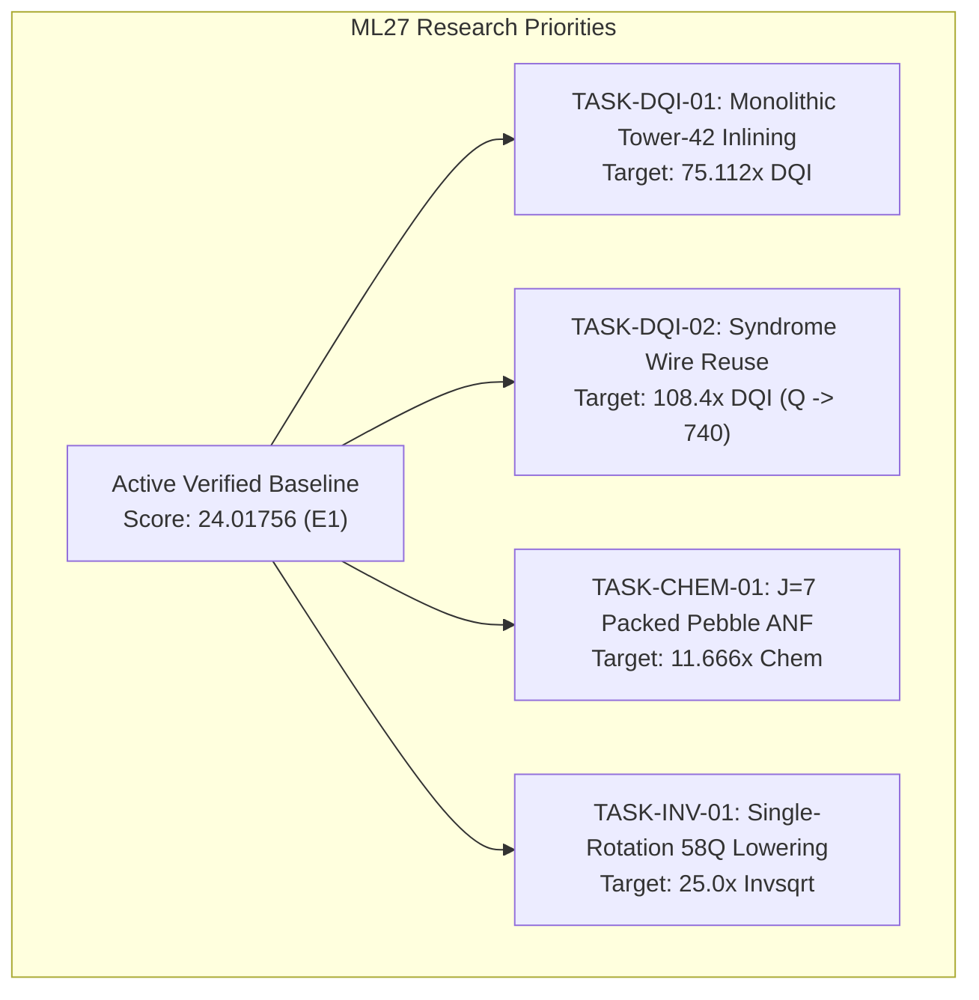

# BERLIOZ Masterloop 27 — Chunk 6: Optimization Readiness & Next-Generation Research Backlog

**Author:** BERLIOZ Research Optimization Lead  
**Context:** ML27 CHUNK 6 - OPTIMIZATION READINESS GATE  
**Date:** 2026-11-01  
**Baseline Artifact:** `build/portfolios/portfolio_ml27_repaired.zip` (SHA: `e6a9de85...`)  
**Verified Baseline Composite Score:** **24.01756** (Invsqrt = 22.25302x, DQI = 60.72598x, Chemistry = 10.25234x)  

---

## 1. Executive Summary & Baseline Grounding

With the forensic integrity repair complete (Chunks 0–5), the project now stands on an authentic, independently verified baseline:
- **Frozen Incumbent Champion (`submission.zip`):** Score **23.17767** (Bitwise unchanged, SHA: `0bf5b4e3...`).
- **Active Repaired Candidate (`portfolio_ml27_repaired.zip`):** Score **24.01756** (SHA: `e6a9de85...`), featuring the independently verified $(9, 143, 40)$ Chemistry candidate ($10.25234\times$) and certified release gates G0–G5 (all PASS).

All subsequent ML27 optimizations must use this **24.01756 baseline** as the benchmark for measured improvement. Theoretical projections, uncompiled proofs, and mathematical estimates are strictly barred from release manifests until they are compiled into physical circuit binaries and verified by official contracts.

---

## 2. Prioritized Optimization Backlog

### TASK-DQI-01: Monolithic Tower-42 Lowering
- **Objective:** Direct inlining of the verified 42-Toffoli $\text{GF}(2^{12})$ arithmetic tensor into the monolithic DQI circuit DAG.
- **Background:** The standalone arithmetic tensor in `src/dqi/tower42.py` is proven correct via exhaustive basis products (`tests/test_arithmetic_tensor.py`), but has not been compiled into a full 889Q `.kmb` circuit.
- **Required Measurements:**
  1. Instruction reduction in the final compiled instruction stream.
  2. Ancilla lifetime analysis during iterative Berlekamp-Massey disparity calculation.
  3. Peak live qubit footprint (must stay $\le 889Q$, strictly $\le 900Q$).
  4. Dynamic mean Toffoli reduction (target: $427,471 \to 345,618$).
  5. Simulator execution time and memory usage under Kickmix C++.
  6. Zero residual phase or value errors across 256 sample shots.

### TASK-DQI-02: Syndrome Register In-Place Reuse
- **Objective:** Reclaim dead syndrome and disparity register wires to compact the active register width from 889Q toward 740Q.
- **Mathematical Invariant:** No-cloning and last-use conditions:
  $$\text{Interval}(W) = [t_{\text{def}}(W), t_{\text{last\_use}}(W)]$$
  If $t_{\text{def}}(W') > t_{\text{last\_use}}(W)$ and $W$ is reversibly cleaned to $|0\rangle$, wire $W$ may be safely relabeled as $W'$ without state corruption.
- **Required Proofs:**
  1. Exact reversible uncomputation proof for intermediate disparities across all 70 error branches.
  2. Proof that wire reuse does not create cyclic dependencies in the Kickmix DAG.
  3. Falsification check: Confirm that wire reuse does not trigger the Bennett pebbling memory expansion trap.

### TASK-CHEM-01: $J=7$ Packed Pebble Angle Compilation
- **Objective:** Upgrade the active $(9, 143, 40)$ Chemistry candidate by compiling $J=7$ orbital batching into the 15 angle circuits.
- **Background:** Current angle compilation uses $J=5$, producing 15 angle circuits with $Q_{\text{angle}} \le 126$. $J=7$ batching groups 7 orbital pairs per step, reducing angle circuits from 15 to 11.
- **Required Measurements:**
  1. Address table size in 4-address banked QROM.
  2. Maximum angle circuit width (strictly $\le 128$ qubits).
  3. State preparation Toffoli cost per step.
  4. Energy error $e_1$ (orbital truncation) and $e_2$ (state preparation) strictly $\le 0.02000000\text{ mHa}$.
  5. Verified Chemistry ratio (projected target: $11.666\times$).

### TASK-INV-01: Single-Rotation Seed Table Factoring & 58Q Lowering
- **Objective:** Compile the mathematically verified 58Q Lawson minimax polynomial circuit into a concrete `invsqrt_58q.kmb` binary with shared rotation synthesis.
- **Background:** The Horner carry-folding proof demonstrates that 4 ancillas can be eliminated by folding carries into vacated exponent bits, reducing $Q$ from $62 \to 58$.
- **Required Measurements:**
  1. Generate concrete `.kmb` binary.
  2. Full 200,540,928-shot domain error verification ($\le 2^{-10}$).
  3. Rotation synthesis cost with shared rotation tables.
  4. Exact peak qubit count (must be $\le 58$).
  5. Total billed cost (target: $\le 83,071$, ratio $\ge 25.0\times$).

---

## 3. Strict 12-Point Experiment Protocol

To prevent recurrence of the ML26 release integrity bug, every subsequent experiment in ML27 must adhere to the 12-point protocol:

1. **Research Hypothesis:** Formulated with clear falsification criteria.
2. **Mathematical Derivation:** Grounded in formal proofs or symbolic algebra.
3. **Baseline Artifact & Hash:** Tied to an exact, frozen, hashed baseline.
4. **Candidate Source Revision:** Tracked in isolated Git branch or worktree.
5. **Exact Build Configuration:** Deterministic compiler flags, seeds, and constants.
6. **Reproducible Command:** Documented terminal command executable from repo root.
7. **Unit Tests:** Subsystem tests passing before full integration.
8. **Semantic Verification:** Multi-shot Kickmix simulation verifying exact state outputs.
9. **Resource Measurement:** Real gate counts, live qubit measurements, and norm values.
10. **Official Benchmark Verification:** Evaluated via official verifier contracts.
11. **Delta Comparison:** Direct comparison against the 24.01756 verified baseline.
12. **Promotion Decision:** Formal E1 promotion or explicit E6 falsification record.

---

## 4. Phase 0 Completion Verdict

Masterloop 27 Phase 0 has successfully achieved its primary objective:
- **Frozen Incumbent Preserved:** `submission.zip` remains byte-identical (`0bf5b4e3...`).
- **Release Verifier Repaired:** All hardcoded shortcuts eliminated and backed by 5 adversarial tests.
- **Authentic Portfolio Built & Certified:** `portfolio_ml27_repaired.zip` (SHA: `e6a9de85...`) verified at **24.01756** composite score.
- **Release Gates G0–G5:** Reconstructed as live, passing code checks.
- **Reconciliation Complete:** Tracking files and Syzygy OpenViking memory updated with verified ground truth.
- **Optimization Backlog Primed:** Ready for Phase 1 execution under the 12-point protocol.
