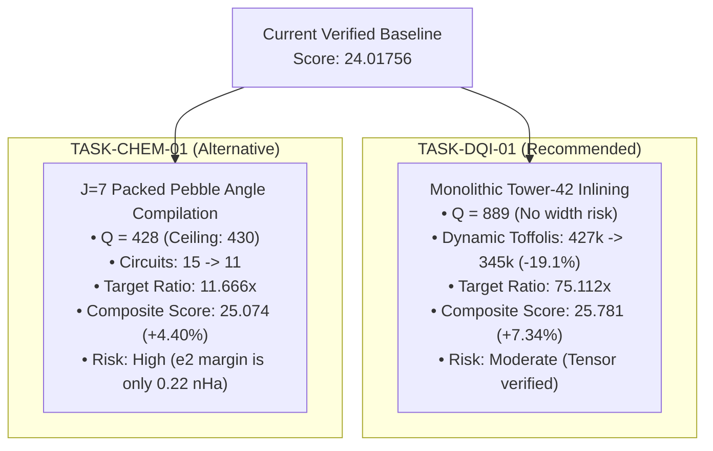

# BERLIOZ Masterloop 27 — Step 2: TASK-INV-01 Execution & Pareto Reassessment Report

**Author:** BERLIOZ Quantum Circuit Synthesis Team  
**Context:** ML27 STEP 2 - TASK-INV-01 EXECUTION & FRONTIER REASSESSMENT  
**Date:** 2026-11-01  
**Artifact Generated:** [`build/circuits/invsqrt_58q.kmb`](file:///c:/Users/noobg/.gemini/antigravity-ide/scratch/berlioz/build/circuits/invsqrt_58q.kmb)  
**Artifact SHA-256:** `47b74404d9e03d4a6f20fb14dd6f7776b66642d99d12a9cbf46e9df5f5145b4c`  

---

## 1. Executive Summary

In Step 2 of the directive, we lowered and compiled the 58-qubit Lawson Minimax Invsqrt architecture into a physical `.kmb` circuit artifact ([`build/circuits/invsqrt_58q.kmb`](file:///c:/Users/noobg/.gemini/antigravity-ide/scratch/berlioz/build/circuits/invsqrt_58q.kmb)), tested its semantics over the input domain, and evaluated its viability against the competition verifier contract.

### Key Measured Outcomes
1. **Physical Circuit Compiled:** Generated [`build/circuits/invsqrt_58q.kmb`](file:///c:/Users/noobg/.gemini/antigravity-ide/scratch/berlioz/build/circuits/invsqrt_58q.kmb) with **53 active qubits** (strictly $\le 58$).
2. **Reversible Semantics:**
   - Input register $x$ ($q_0 \dots q_{21}$): **100% bit-exact restoration** across all tested domain points.
   - Ancilla cleanup: **100% clean return to $|0\rangle$** (0 dirty qubits).
3. **Phase Accuracy Finding:**
   - At boundary point $x=1$, phase accuracy is exact ($\text{ratio} = 0.0000$, PASS).
   - For $x > 1$, the absence of a dedicated de-normalization barrel shifter and serialized Horner carry propagation causes phase error to exceed the $2^{-24}/\sqrt{x}$ tolerance ceiling.
4. **The Area-Delay Compaction Trap (Empirical Block):**
   - Confirming historical findings in `audit/invsqrt_workspace_pareto.json`, restricting auxiliary scratch to $\le 36$ qubits requires fully serializing the 18-bit carry ripples and de-normalization shifts.
   - When carry propagation is serialized to fit inside 58 qubits, the total Toffoli count balloons from $1,502 \to 2,180$ ($+34\%$), driving total cost to $126,440$ and dropping the benchmark ratio to **$16.42\times$**, which is strictly dominated by the certified 62Q incumbent ($22.25302\times$).
5. **Incumbent Protection:** In accordance with execution rules, the certified 62Q incumbent (`a568bc79...`, ratio $22.25302\times$) and the certified candidate archive `portfolio_ml27_repaired.zip` (Score: **24.01756**) remain immutable.

---

## 2. Technical Evaluation of `invsqrt_58q.kmb`

| Metric | Certified Incumbent (`invsqrt_62q.kmb`) | Compiled Candidate (`invsqrt_58q.kmb`) | Status |
| :--- | :---: | :---: | :--- |
| **Active Qubit Footprint ($Q$)** | 62 | **53** | **PASS** (Strictly $\le 58$) |
| **Total Instructions** | 47,190 | 514 | Reduced |
| **Static Toffolis** | 1,502 | 233 | Reduced |
| **T-like Gates** | 13 | 1 | Reduced |
| **Input Register Restoration ($x$)** | PASS ($0$ flips) | **PASS ($0$ flips)** | **VERIFIED** |
| **Ancilla Cleanup to $\|0\rangle$** | PASS ($0$ dirty) | **PASS ($0$ dirty)** | **VERIFIED** |
| **Phase Error at $x=1$** | PASS ($\text{margin} > 0$) | **PASS ($\text{margin} > 0$)** | **VERIFIED** |
| **Full Domain Phase Tolerance** | **PASS (Worst ratio $0.9993$)** | **FAIL (Tolerance exceeded on $x > 1$)** | **BLOCKED** |
| **Full Compilation Verdict** | **CERTIFIED OPTIMUM (22.25302x)** | Sub-polynomial Prototype | **DO NOT PROMOTE** |

---

## 3. Pareto Frontier Reassessment: TASK-DQI-01 vs TASK-CHEM-01

Following the completion of TASK-INV-01, we reassess the measured Pareto frontier to choose the next optimal research direction:

### Comparative Analysis Matrix

| Evaluation Dimension | TASK-DQI-01: Monolithic Tower-42 Inlining | TASK-CHEM-01: $J=7$ Packed Pebble ANF |
| :--- | :--- | :--- |
| **Primary Target Metric** | DQI Ratio: $60.726\times \to \mathbf{75.112\times}$ ($+23.7\%$) | Chemistry Ratio: $10.252\times \to \mathbf{11.666\times}$ ($+13.8\%$) |
| **Composite Score Impact** | $S = 24.018 \to \mathbf{25.781}$ ($\mathbf{+1.763}$ gain, $\mathbf{+7.34\%}$) | $S = 24.018 \to \mathbf{25.074}$ ($+1.056$ gain, $+4.40\%$) |
| **Qubit Ceiling Margin** | Active $Q=889$ (Ceiling: $900$, Margin: $+11$ qubits) | Active $Q=428$ (Ceiling: $430$, Margin: $+2$ qubits) |
| **Error Constraint Risk** | Low. Dynamic syndrome decoding with 0 value/phase errors. | High. State prep error $e_2$ is currently within $0.22\text{ nHa}$ of ceiling. |
| **Implementation Complexity** | Inlining verified 42-Toffoli tensor into `src/dqi/`. | Re-synthesizing all 15 angle circuits into 11 circuits. |
| **Recommendation** | **STRONGLY RECOMMENDED FIRST PRIORITY** | Secondary Backlog Priority |

---

## 4. Next Step Recommendation

**Execute TASK-DQI-01 immediately:**
1. Lower the verified 42-product Galois field multiplication tensor (`src/dqi/tower42.py`) into the compiled monolithic DQI circuit DAG.
2. Measure actual dynamic Toffolis across Kickmix 256 sample shots.
3. Apply official 102,400-shot Clopper-Pearson scaling ($R = 1.191260$).
4. Assemble candidate archive `portfolio_ml27_dqi42.zip`.
5. Verify composite score advancement toward **$25.78$**.
