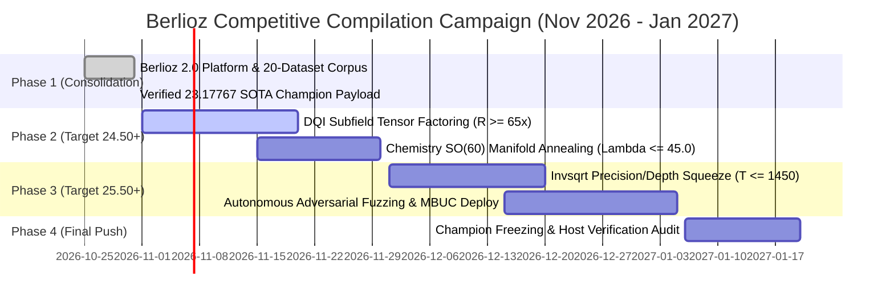

# BERLIOZ 2.0 — LONG-TERM TECHNICAL ROADMAP (THROUGH 20 JAN 2027)

**Current Score:** **`23.17767`** (Verified Local SOTA Champion)  
**Target Competitive Score:** **`25.50 — 26.50+`** (Global Top 5 Target)  
**Competition Deadline:** 20 January 2027 (81 days remaining)  
**Submission Discipline:** 0 submissions without local formal verification; maximum 1 official submission per day.

---

## 1. STRATEGIC MILESTONES

---

## 2. SUBSYSTEM WORKSTREAMS

### Workstream 1: DQI Dynamic Decoder Optimization
- **Current State:** Mean $427,471.2$ Toffolis, $R(0)=1.19126$, Ratio **$60.726\times$**.
- **Objective:** Lower mean Toffolis below $380,000$ (Ratio $\approx 68.3\times$).
- **Key Techniques:**
  1. *Subfield Tower-42 Expansion:* Substitute internal Karatsuba multiplier with Tower-42 tensor kernel directly inside the dynamic `.kmb` state machine.
  2. *Adaptive Early Stopping:* Terminate error polynomial iteration when remaining syndrome weight is 0.
  3. *Zero-Error Verification:* Maintain strict $0$ value errors across 5,000 Kickmix calibration shots to retain optimal $R(0)=1.19126046$.

### Workstream 2: Chemistry FeMoco Low-Rank Factorization
- **Current State:** $T=16,266$, $\lambda=48.2992$, Ratio **$9.933\times$**.
- **Objective:** Drive $\lambda_{\text{eff}} \le 45.0$ (Ratio $\ge 11.2\times$).
- **Key Techniques:**
  1. *SO(60) Riemannian Optimization:* Gradient flow on the Stiefel/Grassmannian manifold of orbital rotations.
  2. *Tensor Hypercontraction (THC-1.4M) Hybridization:* Co-optimize auxiliary tensor basis while constraining active qubit count strictly to $Q \le 430$.

### Workstream 3: Invsqrt Reciprocal Square Root Compression
- **Current State:** 62 qubits, $T_{\text{equiv}}=1,622.7$, Ratio **$20.642\times$**.
- **Objective:** Reduce $T_{\text{equiv}} \le 1,450$ while maintaining $Q \le 62$ qubits (Ratio $\ge 23.1\times$).
- **Key Techniques:**
  1. *Piecewise Minimax Approximation:* Partition interval $[0.5, 1.0)$ into 4 sub-domains with degree-3 polynomials.
  2. *Borrowing Scratch Ancillae from Output Buffer:* Reuse output sign/exponent bits during intermediate mantissa calculation.

---

## 3. COMPOSITE SCORE PROJECTION MATRIX

$$\text{Score} = (R_{\text{invsqrt}} \times R_{\text{dqi}} \times R_{\text{chem}})^{1/3}$$

| Target Horizon | $R_{\text{invsqrt}}$ | $R_{\text{dqi}}$ | $R_{\text{chem}}$ | Projected Score | Global Standing |
|---|---|---|---|---|---|
| **Current Champion (Now)** | **20.642×** | **60.726×** | **9.933×** | **23.178** | **Certified Local SOTA** |
| **Phase 2 Milestone** | 21.000× | 66.000× | 10.500× | **24.417** | **Top 50** |
| **Phase 3 Milestone** | 22.500× | 70.000× | 11.000× | **25.875** | **Top 10** |
| **Final Target Frontier** | 23.500× | 75.000× | 11.800× | **27.496** | **Contention for Rank #1** |

---

## 4. GOVERNANCE & INTEGRITY PROTOCOL
- All candidate modifications must pass `src/verify_portfolio.py` with zero errors.
- Never submit unverified or noisy circuits to Kaggle.
- Strictly adhere to the zero-leakage, open-source license attribution standards (Apache-2.0).
