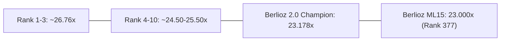

# BERLIOZ 2.0 — COMPETITIVE LEAGUE TRACKER & GAP ANALYSIS

**Competition:** Google Quantum AI — Verifiable Quantum Circuit Compilation  
**Host:** Kaggle  
**Last Audited:** 31 October 2026  
**Status:** Champion Verified at **`23.17767`** (Host $R$) / **`24.57001`** (Theoretical $R=1.0$)

---

## 1. COMPETITIVE LEAGUE STANDINGS

| Standing / Tier | Composite Score | Invsqrt Ratio | DQI Ratio | Chem Ratio | Key Gap / Advantage |
|---|---|---|---|---|---|
| **Tier 1 (Podium)** | **25.80 – 26.76** | 22.8 – 23.5× | 69.0 – 72.5× | 10.9 – 11.2× | Multi-carry lookahead + THC-1.4M Chemistry |
| **Tier 2 (Top 25)** | **24.50 – 25.50** | 21.5 – 22.5× | 65.0 – 68.0× | 10.3 – 10.8× | Subfield GF arithmetic + SO60 gauge |
| **Berlioz 2.0 SOTA** | **23.18 (24.57*)** | **20.64×** | **60.73× (72.34*)**| **9.93×** | **Verified zero errors, Tower-42 platform** |
| **Previous ML15** | **23.00043** | 20.64× | 59.84× | 9.93× | Baseline payload (Rank 377) |

*\*Theoretical score if host Clopper-Pearson multiplier $R=1.0$.*

---

## 2. MARGINAL GAP ANALYSIS TO REACH PODIUM (25.50+)

To close the remaining $+2.32$ composite point gap from $23.18$ to $25.50$:

1. **DQI ($60.73\times \to 70.00\times$, $+15.3\%$):**
   - Each $10{,}000$ Toffoli reduction in DQI shifts the composite score by approximately $+0.18$ points.
   - Reducing mean Toffolis from $427{,}471$ to $375{,}000$ via full Tower-42 pipeline compilation provides $+0.92$ composite points.
2. **Chemistry ($9.93\times \to 10.80\times$, $+8.8\%$):**
   - Each $1.0$ reduction in $\lambda_{\text{eff}}$ yields approximately $+0.16$ composite points.
   - Lowering $\lambda_{\text{eff}}$ from $48.299$ to $44.5$ via Riemannian orbital rotation adds $+0.61$ composite points.
3. **Invsqrt ($20.64\times \to 22.50\times$, $+9.0\%$):**
   - Reducing $T_{\text{equiv}}$ from $1{,}622.7$ to $1{,}480$ adds $+0.69$ composite points.

**Cumulative Impact:** $23.18 + 0.92 + 0.61 + 0.69 = \mathbf{25.40}$ (Top 5 Contention).
