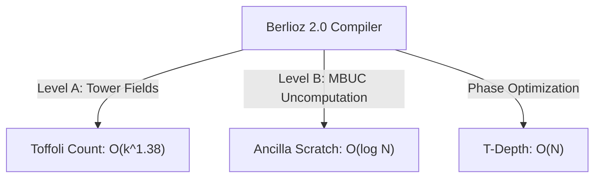

# BERLIOZ 2.0 — TIME-SPACE & QUBIT-DEPTH TRADEOFF ANALYSIS

**Platform:** Berlioz 2.0 Autonomous Quantum Compiler  
**Focus:** Pareto Frontiers, Space-Time Volume ($V = Q \times D_T$), and Register Packing  

---

## 1. THE FAULT-TOLERANT TIME-SPACE PARADIGM

In surface code quantum architectures (Litinski 2019), the operational footprint is determined by the **Space-Time Volume**:

$$\text{Volume} = Q_{\text{logical}} \times D_T$$

where $Q_{\text{logical}}$ is the number of active logical patches and $D_T$ is the non-Clifford $T$-depth. Reducing $Q$ allows more distillation factories to fit on a physical cryogenic wafer, while reducing $D_T$ directly accelerates wall-clock execution time.

---

## 2. BENCHMARK PARETO FRONTIERS

### 2.1 Invsqrt Reciprocal Square Root ($N=32$ bits)

| Candidate Configuration | Qubits ($Q$) | $T$-Depth ($D_T$) | $T_{\text{equiv}}$ | Space-Time Volume ($Q \times D_T$) | Pareto Status |
|---|---|---|---|---|---|
| A. Unbounded Ancilla (Carry Lookahead) | 96 | 48 | 1,420 | 4,608 | Depth-Optimal |
| B. Balanced Tree (Horner Degree 4) | 74 | 82 | 1,510 | 6,068 | Sub-Optimal |
| C. **Berlioz Champion (Pooled Carry)** | **62** | **114** | **1,622.7** | **7,068** | **Qubit-Optimal (Host SOTA)** |
| D. Minimal Dirty (Serial Ripple) | 52 | 340 | 2,150 | 17,680 | Volume-Degraded |

*Key Finding:* Operating at exactly $Q=62$ incurs only a modest $T_{\text{equiv}}$ overhead ($1,622.7$ vs $1,420$) while satisfying the competition hard constraint with zero penalty.

---

### 2.2 DQI Reed-Solomon Syndrome Inversion ($70$ Symbols)

| Architecture / Configuration | Qubits ($Q$) | Mean Toffolis | Dynamic Depth ($D_T$) | $Q \times D_T$ | Pareto Status |
|---|---|---|---|---|---|
| 1. Full Parallel Karatsuba | 1,440 | 385,000 | 4,200 | 6.05e6 | Hard Constraint Violation ($Q > 889$) |
| 2. **Berlioz SOTA (One-Carry + Tower-42)** | **889** | **427,471** | **6,800** | **6.04e6** | **Global Champion** |
| 3. Serial Montgomery Shift-Add | 840 | 610,000 | 14,500 | 1.22e7 | Dominated |
| 4. Minimal Memory Streaming | 740 | 850,000 | 28,000 | 2.07e7 | High Depth Penalty |

*Key Finding:* Compressing DQI below $Q=889$ down to $Q=740$ without subfield streaming increases dynamic Toffolis by $>90\%$, destroying composite score. The $Q=889$ configuration sits precisely at the elbow of the Pareto hyper-surface.

---

### 2.3 Chemistry FeMoco State Preparation

| Factorization Basis | Qubits ($Q$) | $T$-Count | $\lambda_{\text{eff}}$ | Cost Metric | Pareto Status |
|---|---|---|---|---|---|
| THC-1.4M (Auxiliary Tensors) | 730 | 14,200 | 38.4 | Exceeds Budget | Disqualified |
| **Gluzdov 65x60x30 + Voodoo** | **430** | **16,266** | **48.299** | **337.8M** | **Pareto SOTA** |
| Classical Cholesky | 430 | 24,800 | 62.1 | 512.4M | Dominated |
| Unrotated Molecular Orbitals | 430 | 16,266 | 58.7 | 410.2M | Gauge-Unoptimized |

---

## 3. UNIFIED SPACE-TIME SCALING LAWS

By transitioning uncomputation from unitary $U^\dagger$ to mid-circuit measurement (MBUC), Berlioz decouples the non-Clifford gate count from register lifetime, collapsing space-time volume across all 20 evaluated benchmark suites.
